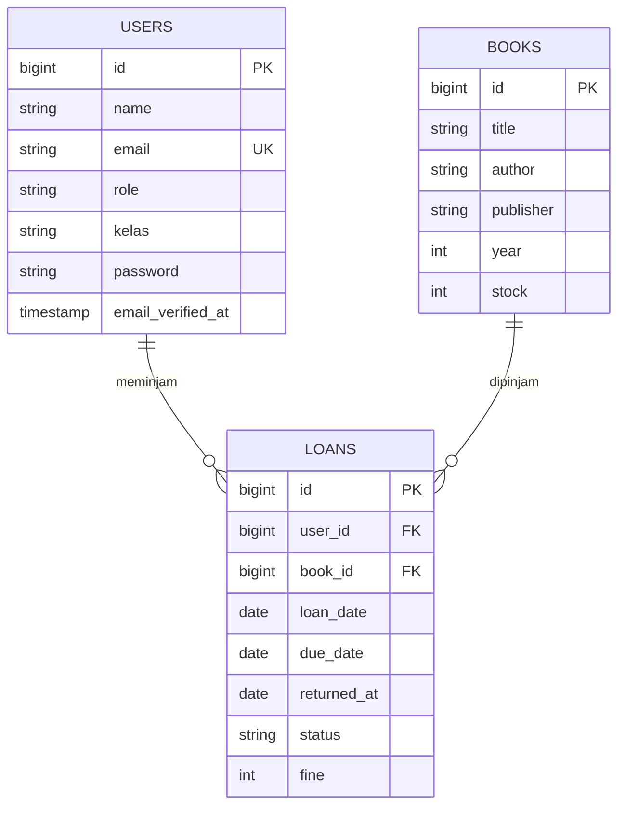

# Aplikasi Peminjaman Buku

Aplikasi web berbasis Laravel untuk mengelola data buku dan peminjaman buku perpustakaan.

## Fitur

- **Books**: kelola data buku (judul, penulis, penerbit, tahun terbit, dan stok).
- **Loans**: catat peminjaman dan pengembalian buku, lengkap dengan tanggal pinjam, batas kembali, status, dan denda.
- **Users**: pengguna dengan peran (`role`, default `siswa`) dan kelas.

## Teknologi

- PHP & Laravel
- MySQL (via XAMPP)
- Composer

## ERD



Keterangan:

- Satu user dapat memiliki banyak peminjaman.
- Satu buku dapat dipinjam berkali-kali.
- `returned_at` bernilai `null` selama buku belum dikembalikan.
- `status` bawaan: `dipinjam`.

## Instalasi

1. Clone repository

   ```bash
   git clone https://github.com/kalilasyifazzahra/peminjaman-buku.git
   cd peminjaman-buku
   ```

2. Install dependency

   ```bash
   composer install
   ```

3. Salin file environment dan generate key

   ```bash
   cp .env.example .env
   php artisan key:generate
   ```

4. Buat database (misalnya `peminjaman_buku`) di phpMyAdmin, lalu atur `.env`

   ```env
   DB_CONNECTION=mysql
   DB_HOST=127.0.0.1
   DB_PORT=3306
   DB_DATABASE=peminjaman_buku
   DB_USERNAME=root
   DB_PASSWORD=
   ```

5. Jalankan migrasi

   ```bash
   php artisan migrate
   ```

6. Jalankan aplikasi

   ```bash
   php artisan serve
   ```

   Buka `http://127.0.0.1:8000` di browser.

## Struktur Database

| Tabel | Keterangan |
|-------|------------|
| `users` | Data pengguna (nama, email, role, kelas) |
| `books` | Data buku dan stok |
| `loans` | Transaksi peminjaman yang menghubungkan user dan buku |

## Lisensi

Proyek ini menggunakan lisensi [MIT](https://opensource.org/licenses/MIT).
